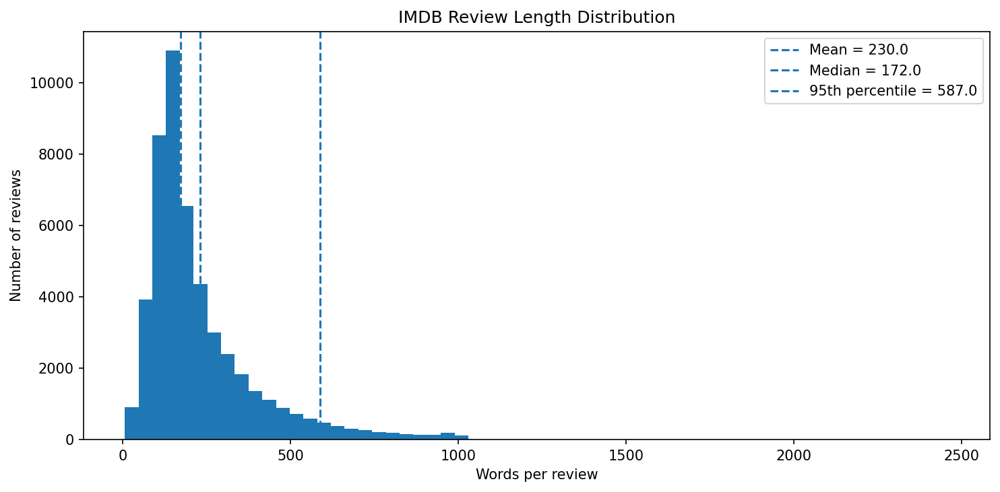
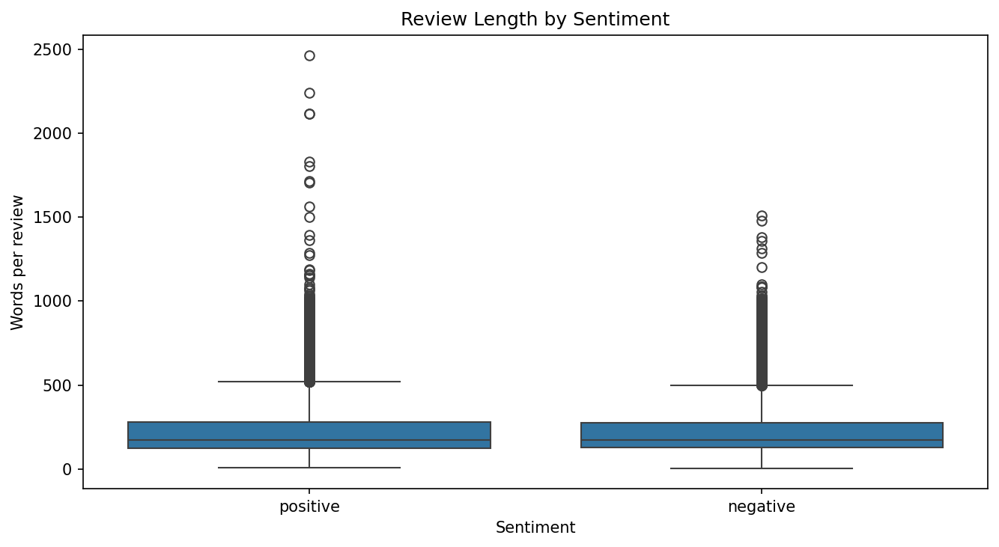
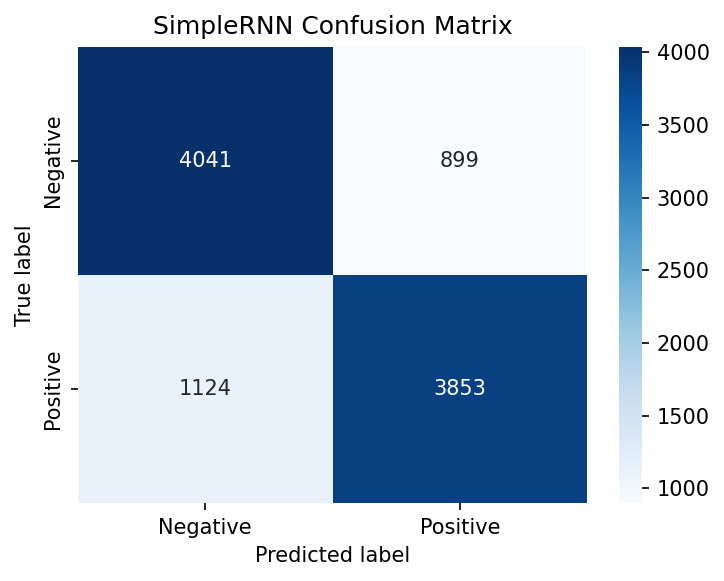
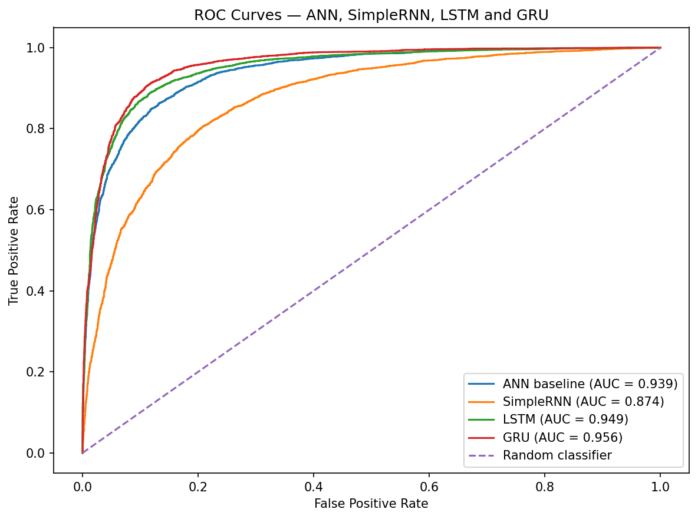

# 🎬 IMDb Sentiment Analysis Using Deep Learning


> **Deep Learning Practical Report 5 — Red & White Skill Education**

A Natural Language Processing (NLP) project that classifies IMDb movie reviews as **positive** or **negative**. It builds a baseline Artificial Neural Network (ANN), then studies and compares recurrent architectures—**SimpleRNN, LSTM, Stacked LSTM, and GRU**—to understand how sequence modelling affects sentiment prediction.

---

## 📑 Table of Contents

- [Project Overview](#-project-overview)
- [Objectives](#-objectives)
- [Dataset](#-dataset)
- [Workflow](#-workflow)
- [Models Implemented](#-models-implemented)
- [Key Visualizations](#-key-visualizations)
- [Evaluation](#-evaluation)
- [Tools and Technologies](#️-tools-and-technologies)
- [Repository Structure](#-repository-structure)
- [Installation and Usage](#-installation-and-usage)
- [Project Scope](#-project-scope)
- [Author](#-author)

---

## 📌 Project Overview

Movie reviews contain useful opinions, but their sentiment can be difficult to classify automatically because meaning depends on words, context, negation, and word order. This project prepares review text and trains deep learning models to predict its sentiment.

The practical also explores **Backpropagation Through Time (BPTT)**, vanishing and exploding gradients, gradient clipping, sequence-length sensitivity, hidden-unit sensitivity, and the differences between basic and gated recurrent cells.

---

## 🎯 Objectives

- Inspect and clean the IMDb review dataset.
- Remove duplicate reviews before splitting the data to reduce data leakage.
- Tokenise text and convert reviews into padded integer sequences.
- Build an ANN baseline and recurrent sentiment classifiers.
- Understand BPTT and investigate vanishing/exploding gradients.
- Compare SimpleRNN, LSTM, Stacked LSTM, and GRU using consistent evaluation metrics.
- Analyse model errors and test sentiment predictions on custom text.

---

## 📂 Dataset

**IMDb Dataset of 50K Movie Reviews**

- **Source:** [Kaggle — IMDb Dataset of 50K Movie Reviews](https://www.kaggle.com/datasets/lakshmi25npathi/imdb-dataset-of-50k-movie-reviews)
- **File:** `IMDB_Dataset.csv`
- **Columns:** `review`, `sentiment`
- **Target labels:** `positive` and `negative`
- **Task:** Binary sentiment classification

The notebook removes exact duplicates, cleans review text, and uses a stratified 80/20 train-test split. The tokenizer is fitted on training text only. The notebook's code uses a vocabulary limit of 10,000 words and selects the sequence length from the 95th percentile of cleaned review lengths.

---

## 🔄 Workflow

1. **Load and inspect** — review dataset shape, columns, class distribution, and missing values.
2. **Clean text** — lowercase text, remove HTML tags and unwanted characters, and normalise whitespace.
3. **Analyse review lengths** — compare distributions and choose a maximum sequence length.
4. **Tokenise and pad** — fit the tokenizer on training text and prepare sequences for neural networks.
5. **Build a baseline** — train an order-blind ANN for comparison.
6. **Train recurrent models** — implement SimpleRNN, LSTM, Stacked LSTM, and GRU.
7. **Study gradient behaviour** — examine BPTT, gradient flow, sequence length, and gradient clipping.
8. **Evaluate and compare** — use accuracy, precision, recall, F1-score, ROC-AUC, confusion matrices, and error analysis.
9. **Run inference** — predict sentiment for custom movie-review text.

---

## 🧠 Models Implemented

| Model | Purpose |
|---|---|
| ANN baseline | Provides a non-recurrent comparison that does not explicitly model word order |
| SimpleRNN | Establishes a basic recurrent sequence model |
| LSTM | Uses gated cell-state memory to help retain information over longer sequences |
| Stacked LSTM | Tests a deeper recurrent architecture |
| GRU | Uses a lighter gated recurrent design with update and reset gates |

The notebook also includes experiments on gradient flow, sequence-length accuracy, gradient clipping, and hidden-unit sensitivity. The best gated model should be selected from the **actual results produced by running the notebook**.

---

## 📊 Key Visualizations

The figures below are generated by the notebook and saved in `plots/`. Run the notebook first so the image files exist in the repository.

### 1. IMDb Review Length Distribution



**Interpretation**
- The distribution is right-skewed: most reviews are shorter than the longest reviews.
- The 95th percentile helps choose a practical maximum sequence length while limiting excessive padding.
- Reviews beyond the chosen maximum length are truncated during sequence preparation.

### 2. Review Length by Sentiment



**Interpretation**
- The boxplot compares review-length spread for positive and negative reviews.
- Both sentiment groups can contain unusually long reviews.
- A shared sequence length is used instead of choosing a different padding length for each sentiment.

### 3. SimpleRNN Confusion Matrix



**Interpretation**
- The diagonal cells represent correctly classified negative and positive reviews.
- Off-diagonal cells show false positives and false negatives.
- The matrix helps identify which sentiment class the SimpleRNN confuses more often; refer to the generated counts rather than assuming either error type is larger.

### 4. ROC Curve Comparison



**Interpretation**
- ROC curves compare true-positive rate against false-positive rate across classification thresholds.
- ROC-AUC summarises how well each model ranks positive reviews above negative reviews.
- The model with the highest measured AUC has the strongest ranking performance in this experiment; check the plotted AUC values after execution.

---


## 📈 Evaluation

The notebook compares models using:

- **Accuracy:** overall proportion of correct predictions.
- **Precision:** proportion of predicted-positive reviews that are truly positive.
- **Recall:** proportion of truly positive reviews correctly identified.
- **F1-score:** balance between precision and recall.
- **ROC-AUC:** ability to distinguish positive from negative reviews across thresholds.
- **Confusion matrix:** breakdown of correct predictions and classification errors.

Results depend on the executed training run and environment. The README intentionally does not claim a winning model or report metric values without the notebook's actual output. Use the final comparison table produced by the notebook for the measured results.

---

## 🛠️ Tools and Technologies

| Category | Tools |
|---|---|
| Language | Python |
| Data handling | Pandas, NumPy |
| Visualisation | Matplotlib, Seaborn |
| Deep learning | TensorFlow / Keras |
| Machine learning metrics | Scikit-learn |
| Environment | Google Colab / Jupyter Notebook |
| Version control | Git and GitHub |

---

## 📁 Repository Structure

```text
IMDB_Sentiment_Analysis_Using_DeepLearning/
│
├── README.md
├── DL_PR5.ipynb
├── IMDB_Dataset.csv
├── requirements.txt
│
├── plots/
│   ├── length_distribution.png
│   ├── length_boxplot_by_sentiment.png
│   ├── rnn_forward_heatmap.png
│   ├── training_curves_rnn.png
│   ├── confusion_matrix_rnn.png
│   ├── gradient_norms_rnn.png
│   ├── accuracy_vs_sequence_length.png
│   ├── exploding_gradient_clipping.png
│   ├── training_curves_lstm.png
│   ├── gradient_norms_rnn_lstm.png
│   ├── training_curves_gru.png
│   ├── gradient_norms_all_cells.png
│   ├── hidden_unit_accuracy.png
│   ├── hidden_unit_parameters.png
│   ├── roc_curves.png
│   └── accuracy_by_length.png
│
└── sample_data/
```

**Note:** The `plots/` image files are generated as the notebook runs. The `sample_data/` folder was visible in the provided Colab file panel; keep it if it is part of your repository. The notebook also exports an HTML report if you create it. Only commit files that are actually present in your local project.

---

## 🚀 Installation and Usage

### 1. Clone the repository

```bash
git clone https://github.com/PareeSojitra0803/IMDB_Sentiment_Analysis_Using_DeepLearning.git
cd IMDB_Sentiment_Analysis_Using_DeepLearning
```

### 2. Install dependencies

```bash
pip install -r requirements.txt
```

### 3. Check the dataset filename

Place `IMDB_Dataset.csv` in the repository root, next to `DL_PR5.ipynb`. The notebook reads the dataset from the project root. Make sure the filename matches the code exactly.

### 4. Run the notebook

Open `DL_PR5.ipynb` in Google Colab or Jupyter Notebook and run the cells from top to bottom. Deep learning training can take time, depending on the available CPU/GPU and runtime environment.

---

### Main dependencies

```text
numpy
pandas
matplotlib
seaborn
scikit-learn
tensorflow
```

If your `requirements.txt` specifies compatible versions, use those versions for the most reproducible environment.

---


## 🎓 Project Scope

**Included:** text cleaning, tokenisation, padding, ANN baseline, SimpleRNN, BPTT, vanishing/exploding gradients, gradient clipping, LSTM, Stacked LSTM, GRU, gradient-flow comparison, hidden-unit sensitivity, model evaluation, error analysis, and custom inference.

**Intentionally excluded:** Bidirectional RNNs, Attention, Transformers, and pretrained embeddings.

---

## 🎥 Project Explanation Video

A walkthrough of the project covering the dataset, text preprocessing, deep learning architectures, model evaluation, and key findings.

**▶️ https://drive.google.com/file/d/1RpW1M-OW9Mr1UfWoWHG33GZ0IehrfXjU/view?usp=sharing**


---
## 👩‍💻 Author

***Paree Sojitra***  
Data Science & AI/ML Student

- **GitHub:** [PareeSojitra0803](https://github.com/PareeSojitra0803)
- **Project Repository:** [IMDb Sentiment Analysis Using Deep Learning](https://github.com/PareeSojitra0803/IMDB_Sentiment_Analysis_Using_DeepLearning)

---

⭐ If you find this project useful, feel free to explore the notebook and its experiments.
